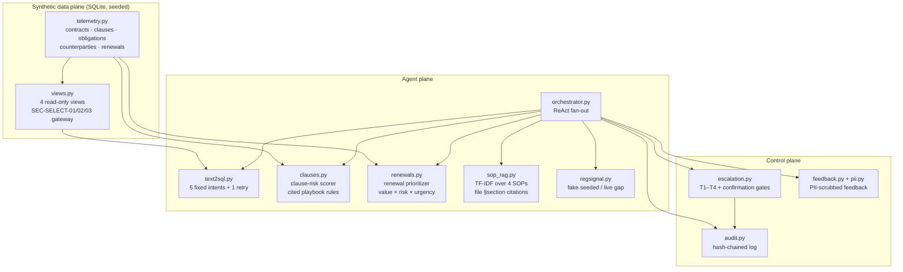

# Architecture

## How it works, step by step
1. `telemetry.seed_db()` builds the synthetic SQLite database (seed 42,
   fixed reference date 2026-10-18).
2. `views.create_views()` materializes contract risk (via the clause
   scorer) and renewal priority into helper tables, then exposes the four
   read-only views.
3. A question reaches `Orchestrator.run()`: text-to-SQL maps it to one of
   five fixed templates (one simplified retry, then escalation); the SOP
   RAG answers process questions with citations; the regulatory signal
   reports changes or an explicit gap.
4. `score_contract()` runs every clause of a contract through the
   playbook and returns per-clause breakdowns plus the contract total.
5. `rank_renewals()` scores every undecided renewal on value, risk, and
   urgency and returns the ranked pipeline.
6. Gated actions (`approve_contract`, `accept_high_risk_clause`) require
   a human confirmation gate; a timed-out gate denies by default.
7. Every turn, escalation, and decision is appended to the hash-chained
   audit log; feedback text is PII-scrubbed before storage.

## Key decisions (ADRs, short form)
- **Fixed-template text-to-SQL, not generated SQL.** Deterministic,
  auditable, and the SELECT-only gateway is enforceable. Cost: no
  ad-hoc questions — anything outside the five intents escalates.
- **Clause rules as code with cited IDs.** Every risk finding traces to
  a named playbook rule, which is what legal reviewers need to trust or
  challenge a score.
- **Contract risk = sum of clause scores (capped).** A contract with
  several medium-risk clauses reads as high risk, matching how counsel
  actually triages a redline.
- **Explicit signal gaps.** The regulatory feed never hallucinates;
  unavailability is reported as a gap.
- **PII scrubbing before storage.** Feedback free text is scrubbed by
  `pii.py` before it touches the store; redaction counts are kept.
